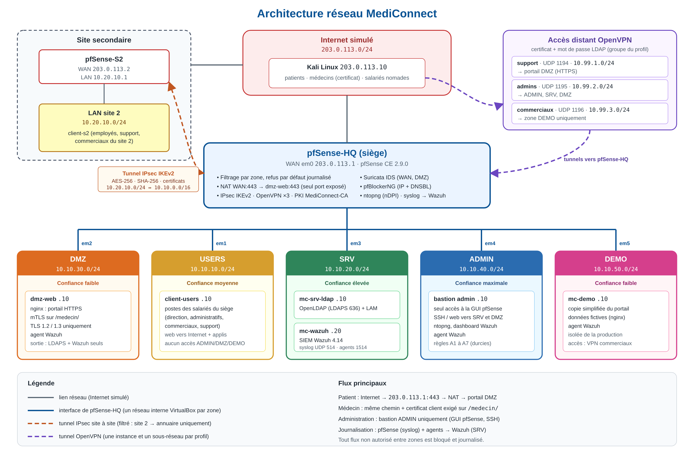

# MediConnect – Architecture réseau sécurisée

Projet réalisé seul en 4e année d'ingénieur à l'EFREI, dans le cours Sécurité des réseaux.

L'objectif était de concevoir l'infrastructure réseau sécurisée d'une plateforme fictive de prise de rendez-vous médicaux, comme Doctolib, répartie sur deux sites. L'application web est considérée comme existante, mon travail porte uniquement sur le réseau. Tout le lab tourne sous VirtualBox avec pfSense CE 2.9.0.

## Ce qui a été mis en place

- Un pare-feu pfSense par site, avec 5 zones (DMZ, utilisateurs, serveurs, administration, démo), un niveau de confiance par zone et un blocage par défaut journalisé
- Un tunnel IPsec IKEv2 entre le siège et le site secondaire, authentifié par certificats
- Trois accès distants OpenVPN (support, admins, commerciaux), chacun limité à son groupe LDAP et à une seule zone
- Un annuaire OpenLDAP et une PKI interne
- Une authentification des médecins par certificat client (mTLS) sur le portail
- Des règles de filtrage basées sur l'identité de l'utilisateur
- pfBlockerNG pour bloquer les IP et domaines malveillants, et Suricata pour détecter les intrusions
- Les logs centralisés dans Wazuh, avec des règles personnalisées

## Plan d'adressage

| Zone | Réseau |
|---|---|
| WAN (Internet simulé) | `203.0.113.0/24` |
| USERS | `10.10.10.0/24` |
| SRV | `10.10.20.0/24` |
| DMZ | `10.10.30.0/24` |
| ADMIN | `10.10.40.0/24` |
| DEMO | `10.10.50.0/24` |
| Site 2 (LAN) | `10.20.10.0/24` |

## Tests réalisés

Chaque flux autorisé et chaque flux interdit a été testé. Quelques exemples :

- `alice` s'authentifie sur le VPN support mais pas sur le VPN admins
- `eva` (admins) atteint la zone SRV mais pas la zone DEMO, et `farid` (commerciaux) fait l'inverse
- Le portail `/medecin/` répond 403 sans certificat et 200 avec un certificat médecin valide
- Un scan `nmap -sS` depuis l'extérieur est bloqué par le pare-feu, détecté par Suricata et visible dans Wazuh

## Limites

Pas de double authentification TOTP, pas de liste de révocation des certificats, pas de redondance des pare-feux, syslog en UDP non chiffré. Elles sont détaillées dans le rapport avec les pistes d'amélioration.

## Contenu du repo

- [Rapport complet (PDF)](docs/Rapport_MediConnect.pdf)
- [Captures d'écran (PDF)](docs/Captures_MediConnect.pdf)
- Vidéo de démonstration : *(lien YouTube non répertorié à ajouter)*

## Outils

pfSense, VirtualBox, OpenVPN, IPsec (strongSwan), OpenLDAP, nginx, pfBlockerNG, Suricata, ntopng, Wazuh, Kali Linux
